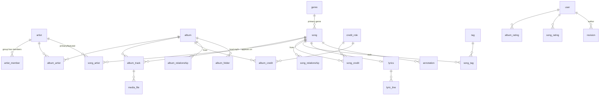

# Domain model (DRAFT for approval)

Not implemented yet. Decisions behind it: `docs/decisions/0002-domain-and-import-decisions.md`.
Conventions: PostgreSQL, snake_case, `bigint` identity primary keys (readable URLs like `/artists/1`), `created_at`/`updated_at` everywhere. "Nullable" means optional.

## Overview

## Column order (every table)
PostgreSQL cannot reorder columns later, so the order is fixed by convention and applied through `sort_order` in `models/base.py`:
1. key and external id: `id`, `genius_id`
2. name parts: `name`, `variant` (album and song only), `base_name`, `disambiguator`
3. `artist_type` / `album_type` (where the entity has a type), then `import_state`
4. the entity's own columns (declaration order)
5. `created_at`, `updated_at`

**Editing and deleting are not modelled yet** (removed on purpose, to be designed together with the frontend): no `notes`, `manual_fields`, `row_version` (optimistic locking), `deleted_at` (soft delete), `manually_overridden`, `source_genius_song_id` and no detach. They come back with the edit mode, once it is clear what the user wants to edit and delete.

**Unknown is NULL.** A stub (and any link row made from a list) stores only what the list said. Nothing is filled with a guess or a default: `artist_type`, `is_verified`, `is_meme_verified`, `album_type`, `album_track.disc_number`, `sort_order` and `is_primary` are nullable.

## Shared columns (artist, album, song)
| column | notes |
|---|---|
| `id` | bigint identity |
| `genius_id` | bigint, unique, nullable (manual entities have none) |
| `import_state` | `stub` or `full`; manual entities are `full` |

**Storage rule:** no JSON columns for modeled data; use normalized tables. Accepted exceptions: `genius_response.raw` (the untouched response of an entity, one row per entity, kept for replaying an import and for fields we do not store; see ADR 0005) and `revision.changes` (history diffs).

## Names (artist, album, song, genre, tag)
`name` (original full string, as received) + `base_name` + `disambiguator` (alternative-language name) and, for album and song only, `variant` (Freestyle, Remix, Live, Deluxe, feat. X).
Splitting happens at import and in the creation forms, and is editable.

Algorithm: peel trailing `(...)` groups from the end. For each group: if it contains a version word (feat, remix, mix, edit, live, demo, deluxe, remaster, freestyle, acoustic, instrumental, version, skit, intro, outro, pt, part, ...) it goes to `variant`; else if the base has non-Latin letters and the group is Latin, it becomes `disambiguator` (first one only); otherwise it goes to `variant`. A leading parenthesis is never peeled. Tested on:

| name | base_name | variant | disambiguator |
|---|---|---|---|
| Надоела (Freestyle) (Tired of you) | Надоела | Freestyle | Tired of you |
| Группа крови (Blood Type) | Группа крови | | Blood Type |
| КИНО (KINO) | КИНО | | KINO |
| Creep (Live) | Creep | Live | |
| Canal St. (feat. A$AP Rocky) | Canal St. | feat. A$AP Rocky | |
| (What's the Story) Morning Glory? | unchanged | | |
| Русский (In Russian) (tag) | Русский | | In Russian |

Known limit: a Latin group on a non-Latin base that is not in the version-word list (e.g. `Песня (Special)`) becomes a disambiguator. The word list is a config; fix by adding words or by hand.

## Tables

### artist
`artist_type` comes after the name parts, then `import_state`. Own columns, in order: `artist_type` (`group` when it has members, `person` after a full import without members, NULL for a stub nobody called a group; also label, other; to be reworked later), `description` (plain text built from the `dom` tree of the response), `genius_url`, `cover_url`, `is_verified`, `is_meme_verified`, `followers_count`.
- `artist_alias(id, artist_id, name)`: alternative names (unique per artist). Import only adds missing aliases and never removes any, so aliases typed by hand survive.
- `artist_member(group_id, member_id, position)`: membership. Having members implies `artist_type = group` at import.
- Genius `social_links` (Spotify, YouTube, website, ...) are not stored in a table: the artist page reads them from the stored response. Genius annotations and viewer-specific fields (`current_user_metadata`, tracking, share texts) are deliberately not stored.

### album
`album_type` (album, ep, single, compilation, live, mixtape, soundtrack, other; a type Genius adds one day is added to `AlbumType`, the import of the album stops with an error until then) comes after the name parts, then `import_state`. Own columns, in order: `language`, `release_date` + `release_date_precision` (taken from `release_date_components`: year only gives `YYYY-01-01` with precision `year`; no database CHECK), `is_released` (false when the album has no date or a `*` in its title, e.g. `OFF THE STRENGTH*`; NULL for a stub), `description` (plain, empty or "?" becomes NULL; the full text is read from the description annotation), `genius_url`, `cover_url`, `cover_thumbnail_url`, `cover_primary_color`, `cover_secondary_color`. Not stored: see `docs/parked-fields.md`.
- `album_artist(album_id, artist_id, position)`: main artists, read only from `primary_artists[]`.
- `album_cover_art(id, genius_id, album_id, position, explicit, image_url, thumbnail_image_url, genius_url)`: every cover Genius knows (0-3 per album); the main one is also `album.cover_url`.
- `album_relationship(album_id, related_album_id, type)`: types `deluxe_edition_of`, `alternate_version_of`, `reissue_of`, `remix_version_of`. Genius lists each relation from both sides (`deluxe_edition_of` and `deluxe_editions`, ...); we store it once, in the "of" direction. Related albums become stubs.
- `album_credit(album_id, artist_id, role_id, label_text)`: all of `performance_groups[]` (Label, Copyright, Phonographic Copyright, ...). This is where the label-to-artist link appears.
- `album_folder(album_id, path)`: local mp3 folders (later). `album_track`: see below.

Importing: see `docs/decisions/0004-import-ui-and-jobs.md` (the handler of each entity saves it and queues what must be imported in full; related albums and songs of a tracklist are imported in full, their own relations are stubs).

### album_track (a song's placement on an album)
`album_id, song_id, disc_number, position, sort_order` (order of arrival in the album's tracklist, fallback ordering), `is_primary` (the song's primary album). The last four are nullable: the album import knows the numbers, the song import knows the primary album, each fills in only its part.
Order tracks by `(disc_number, position nulls last, sort_order)`.

### song
Own columns, in order: `language`, `release_date` + `release_date_precision` (from `release_date_components`; an unreleased song has no `release_date` but still has components), `description` (plain; empty or "?" becomes NULL), `recording_location`, `explicit`, `instrumental`, `is_music`, `hidden`, `published` (NULL for a stub: it does not know them), `lyrics_state`, `genre_id`, `genius_url`, images (`cover_url`, `cover_thumbnail_url`), colors (`cover_primary_color`, `cover_secondary_color`), `view_count` (Genius `stats.pageviews`). No other counters. Not stored: see `docs/parked-fields.md`.
- `song_artist(song_id, artist_id, role, position)`: `primary_artists[]` and `featured_artists[]`.
- `song_credit(song_id, artist_id, role_id, label_text)`: `writer_artists[]` (role "Writer"), `producer_artists[]` (role "Producer"), and every entry of `custom_performances[]` (Label, Distributor, Copyright, Mixing Engineer, Vocals, ...).
- `song_tag(song_id, tag_id)`: all of `tags[]` (the primary tag included); `genre_id` is `primary_tag`.
- `song_relationship(song_id, related_song_id, type)`: the 12 Genius names are 6 types, each stored once in the "of" direction (samples, interpolates, cover_of, remix_of, live_version_of, translation_of); related songs are stubs.
- `song_audio(id, song_id, provider, url, native_uri, attribution)`: from `media[]` that is not a video (SoundCloud, Spotify); not a local file.
- `song_video(id, song_id, explicit, official, url, start_seconds)`: from `media[]` of type video; the importer takes every one of them for YouTube, so there is no provider. `explicit` and `official` (boolean, default false; `official` is the official clip and not just the audio put on YouTube) are set by hand and never touched by the import.
- `album_track`: see below.

### Dictionaries
- `genre(id, genius_id, name, base_name, disambiguator)`: from `primary_tag`.
- `tag(id, genius_id, name, base_name, disambiguator)`: all Genius tags.
- `credit_role(id, name unique)`: normalized roles; override only from existing rows (admin can add new ones on a separate page).

### Lyrics and annotations (placeholders, no logic yet)
- `lyrics(id, song_id unique, source, is_synced)` and `lyric_line(lyrics_id, position, text, start_ms nullable, end_ms nullable)`. Timecodes switch lines during playback. Content later comes from local JSON files; until then the UI shows placeholder text.
- `annotation(id, song_id, line_from, line_to, body, source)`: empty stub, no logic.

### Ratings and reviews (real, empty)
- `album_rating(user_id, album_id, score smallint 1..10)`, `song_rating(user_id, song_id, score 1..10)`; unique per user and target.
- `album_review(id, user_id, album_id, body)`, `song_review(id, user_id, song_id, body)`.

### Users
`user(id, login unique, password_hash, role)` with roles `viewer`, `editor`, `admin`; `session(id, user_id, expires_at)`. Seed `admin/admin` and dev auto-login behind one config flag.

### Local media
- `media_file(id, album_track_id, path, format, duration_ms, size_bytes, content_hash)`: a file belongs to the placement on an album, not to the song.

### History
`revision(id, entity_type, entity_id, user_id nullable, action, changes jsonb, reason, created_at)`: action is `create`, `update`, `delete`, `import`; `changes` holds per-field `{field: [old, new]}`; `user_id` null means system (author "genius-import" is a seeded system user). No foreign key to the entity (polymorphic on purpose).

`genius_response(entity_type, entity_id, raw jsonb, created_at, updated_at)`: the last Genius response of an artist, album or song, written together with a real change (polymorphic like `revision`).

### Soft delete
Not built yet (see the note under "Column order"). Planned: no delete for artist, album (and song, to confirm); `deleted_at` on deletable rows only (`album_track`, credits, relationships, reviews, ratings) with partial unique constraints.

## Creation forms (artist, album, song)
Opened from edit mode on `/artists/new`, `/albums/new`, `/songs/new`. Saved entities are `full`, with no `genius_id`. Autocomplete fields can create a missing entity on the fly as a minimal one.

**Artist form:** name (required, live preview of `base_name`/`disambiguator`), type, notes, aliases (chips), description, image (URL or file), members (autocomplete, for groups). Social links come with their table later.

**Album form:** name (required, preview of `base_name`/`variant`/`disambiguator`), type, notes, release date (year required, month and day optional), primary artists (required, autocomplete multi), cover, description, tracklist editor (rows: song autocomplete or "create new song", disc and position, drag to reorder, mark primary album), album credits (role + artist), related albums (type + autocomplete), local folders, genres and tags.

**Song form:** name (required, preview), notes, primary artists (required), featured artists, release date, placements on albums (album + disc + position), genre (select from existing), tags (multi-select from existing), credits (role + artist), relationships (type + song), lyrics (text with optional timing editor), language.

**Rule: everything added through a form lives in the database.** Artists, genres, tags and credit roles are never free text on a song or album: each is a row in its own table, linked by foreign key. When you type a name that does not exist yet, the form creates the row (artist as a minimal `full` entity, genre, tag or role in its dictionary table) and then links it.

No validation beyond types and required fields: Genius is trusted, and checks are added only when a test or a real run shows a problem (see CLAUDE.md).

## Routing
Path URLs without `#`: `/artists/[id]`, `/albums/[id]`, `/songs/[id]`, `/genres/[id]`, `/tags/[id]`, `/search`, plus `/artists/new`, `/albums/new`, `/songs/new`. Edit mode is a toggle on each page (no separate edit routes). SvelteKit path routing with SSR so deep links survive refresh.

## Resolved
- `variant` is always shown; only `disambiguator` is hidden by default (toggle in settings).
- Dev ports: frontend on 8080, backend on 8000, Vite proxies `/api` so everything is one origin.
- Genres of album and artist are derived from their tracks; no override tables for now.
- `tags` also contains the primary tag (as Genius lists it).
- A song is a "big" entity: no delete for now.
- Lyric timecodes belong to the song.

- Integer ids (`bigint identity`), confirmed.
- Creation form field list confirmed, plus `notes` on artist, album and song.
- `artist.kind` renamed to `artist_type`.

## Open
None for the schema. Awaiting approval of this document as a whole.

## Parked ideas (decided not now, kept on purpose)
- `search_vector` (PostgreSQL full-text column): add with the catalog search.
- `created_by` / `updated_by` on entities: not needed while `revision` records the author of every change.
- `fetched_at` (when an entity was last imported): declined for now.
- No deletion of big entities for now; `deleted_at` itself is removed until the delete flow is designed.
- Genius `social_links` table (Spotify, YouTube, website, ...).

## Constraints policy
The database holds keys (PK, FK, NOT NULL) and the uniqueness the code looks things up by: `genius_id` (artist, album, song, genre, tag), `app_user.login`, dictionary names (genre, tag, credit role), `media_file.path`, `lyrics.song_id` (one text per song) and one active import job per target. There are no CHECK constraints (enum values, `not_self`, date/precision, score range, track positions) and no "one primary album" or "unique position" indexes. Partial dates are stored as Genius gives them: `release_date` (padded with 1) plus the precision taken from `release_date_components`.
